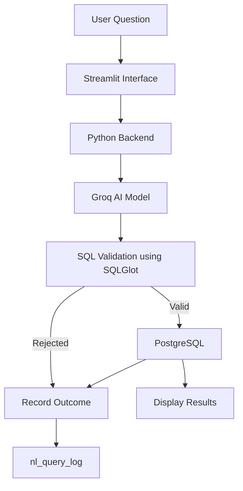

# AI-to-SQL Job & Resume Search System

Ask questions about jobs and candidates in plain English. An AI model generates SQL, the application validates it, and PostgreSQL executes permitted queries. Request outcomes are recorded in an audit log.

> **Academic DBMS Project:** The AI proposes queries, while application rules and database controls govern execution.

## Table of Contents

1. Problem and Solution
2. Features
3. Architecture
4. Tech Stack
5. Database Design
6. SQL Validation
7. Security and Audit Logging
8. Setup
9. Example Questions
10. Results Snapshot
11. Limitations and Future Work
12. Data Disclaimer

## Problem and Solution

**Problem:** Searching across jobs, companies, locations, skills, and candidate profiles requires SQL knowledge.

**Solution:** A natural-language interface that converts user questions into SQL, validates the generated queries, executes permitted requests, and logs outcomes.

## Features

- Natural-language job and candidate search.
- AI-generated PostgreSQL queries using schema context.
- SQL validation using SQLGlot.
- Query restrictions through five approved database views.
- Read-only transaction settings and a 10-second statement timeout.
- Audit logging of request outcomes and processing times.
- Streamlit interface for generated SQL and query results.

## Architecture



**Workflow:** Ask → Generate → Validate → Execute → Log and Display.

## Tech Stack

| Technology | Purpose |
|---|---|
| Python | Application logic |
| Streamlit | User interface |
| PostgreSQL 18 | Database |
| pgAdmin 4 | Database administration |
| Groq | SQL generation |
| SQLGlot | SQL parsing and validation |
| psycopg2-binary | Database connectivity |
| Pandas | Result formatting |
| python-dotenv | Environment configuration |

## Database Design

The database contains normalized recruitment data, supporting views, indexes, and an audit log.

### Dataset

| Component | Records |
|---|---:|
| Job postings | 12,894 |
| Companies | 5,283 |
| Locations | 2,506 |
| Skill vocabulary | 585 |
| Synthetic candidates | 500 |
| Synthetic experience records | 750 |

### Main Tables

| Tables | Purpose |
|---|---|
| `jobs`, `companies`, `locations` | Job and company information |
| `skills`, `skill_vocabulary`, `job_skills` | Skill information and job-skill relationships |
| `candidates`, `experience`, `resumes`, `candidate_skills` | Candidate profiles and skills |
| `stg_postings` | Imported job-posting data |
| `nl_query_log` | Request audit records |

### Approved Views

| View | Purpose |
|---|---|
| `v_job_catalogue` | Job details, company, and location |
| `v_job_required_skills` | Jobs and required skills |
| `v_candidate_profiles` | Candidate profiles and experience |
| `v_candidate_skills` | Candidate skills and proficiency |
| `v_company_job_counts` | Job counts by company |

Indexes include B-tree indexes and trigram GIN indexes using `pg_trgm` for text search.

## SQL Validation

Before execution, the application applies these checks:

| Check | Purpose |
|---|---|
| Output cleaning | Removes Markdown fences and whitespace |
| SQL parsing | Parses SQL using the PostgreSQL dialect |
| Single statement | Rejects multiple statements |
| Root `SELECT` | Requires a SELECT query |
| Forbidden operations | Rejects specified INSERT, UPDATE, DELETE, DROP, CREATE, ALTER, and COMMAND nodes |
| Table reference | Requires at least one table or view |
| Approved-view allowlist | Restricts references to five approved views |
| Schema qualification | Rejects schema- or database-qualified names |
| Automatic `LIMIT 50` | Adds a limit when the root query has none |
| Execution controls | Uses a read-only transaction and a 10-second timeout |

A prototype PostgreSQL function, `validate_nl_sql(p_sql TEXT)`, also exists as an additional validation component.

## Security and Audit Logging

- **Query restrictions:** Only approved views are allowed by the application validator.
- **Execution controls:** Read-only transaction settings and a statement timeout provide additional safeguards.
- **Restricted role:** The `nl_reader` role has SELECT permissions on approved views. The application must use a restricted login for these database permissions to enforce access limits.
- **Audit log:** `nl_query_log` records the request, generated SQL when available, status, rejection reason, processing time, and timestamp.
- **Secrets:** API keys and database credentials are stored in `.env`, which must not be committed to GitHub.

Application-level validation alone does not guarantee complete SQL security.

## Setup

### Requirements

- Python 3.10+
- PostgreSQL 18
- Groq API key

### 1. Clone the Repository

```bash
git clone https://github.com/akshiy1804/AI-to-SQL-Job-Resume-Search.git
cd AI-to-SQL-Job-Resume-Search
```

### 2. Install Dependencies

```bash
python -m venv .venv
.venv\Scripts\activate
pip install streamlit psycopg2-binary pandas python-dotenv sqlglot groq
```

### 3. Configure the Database

Create the PostgreSQL database and run the project's SQL setup scripts to create tables, load data, create views and indexes, and configure the audit log.

### 4. Configure `.env`

Use the variable names expected by `app.py`:

```env
DB_HOST=localhost
DB_PORT=5432
DB_NAME=jobid
DB_USER=your_database_username
DB_PASSWORD=your_database_password
GROQ_API_KEY=your_groq_api_key
```

Replace the example credentials with your actual configuration. Confirm the database name before running the application.

### 5. Run the Application

```bash
streamlit run app.py
```

Open the local URL displayed in the terminal, usually `http://localhost:8501`.

**Never commit your `.env` file or API key to GitHub.**

## Example Questions

**Supported requests**

- Show candidate profiles.
- Find candidates who know SQL.
- Find jobs requiring Java.
- Show companies with the most job openings.

**Requests that should be rejected or marked unsupported**

- Delete all candidate records.
- Update every candidate's city.
- Drop the jobs table.
- Create a new table named `test_table`.

An unsupported request rejected by the AI prompt is different from generated SQL rejected by SQLGlot. Both outcomes should be distinguished during evaluation.

## Results Snapshot

Current audit-log snapshot: **42 requests**.

| Outcome | Count | Percentage |
|---|---:|---:|
| Accepted | 23 | 54.76% |
| Rejected | 11 | 26.19% |
| Error | 8 | 19.05% |

These figures describe logged outcomes, not validator accuracy. Some errors were API connection failures. Measuring unsafe-query detection and false-rejection rates requires a labelled test set.

## Limitations and Future Work

- Investigate API connection failures and improve error classification.
- Use a dedicated least-privilege PostgreSQL login.
- Expand validation for potentially unsafe SQL constructs and functions.
- Build a labelled test set to measure validation accuracy.
- Improve skill matching and complex-query generation.
- Add pagination, CSV export, and automated tests.
- Evaluate query performance using `EXPLAIN ANALYZE`.

## Data Disclaimer

Job postings were imported from an open-source Kaggle dataset.
"Data Analyst Job Postings" by asaniczka
(LinkedIn job listings augmented with job skills): [ https://www.kaggle.com/datasets/asaniczka/data-analyst-job-postings]


Candidate and experience records are synthetic and intended for demonstration only. Search results must not be used for real hiring decisions.

## Author

**Akshi Yadav**

Academic DBMS Project

